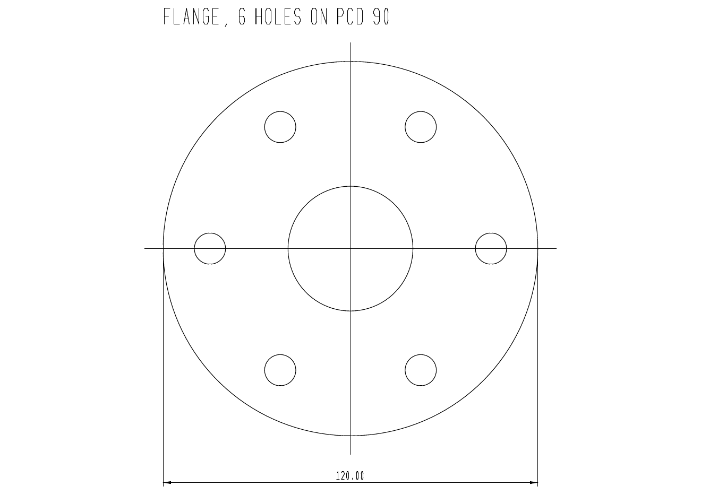
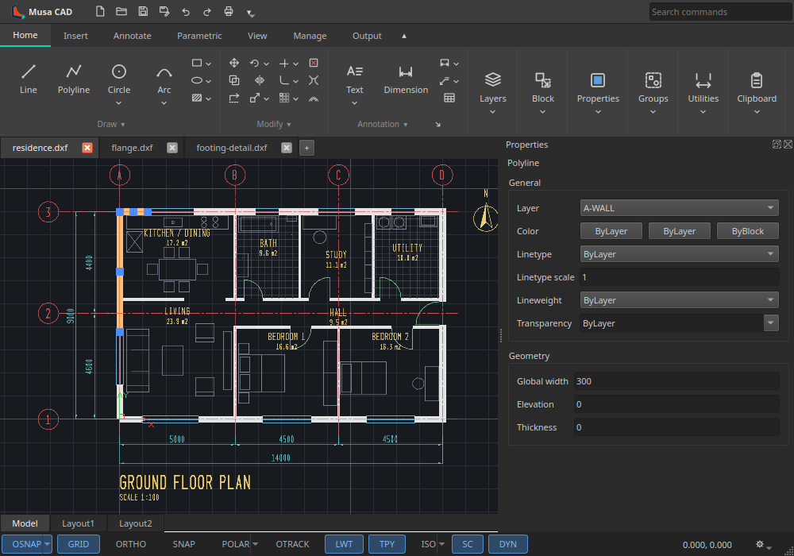
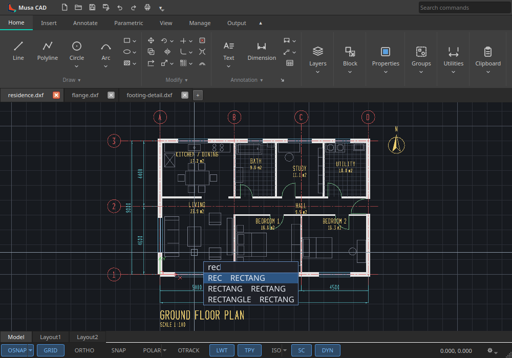
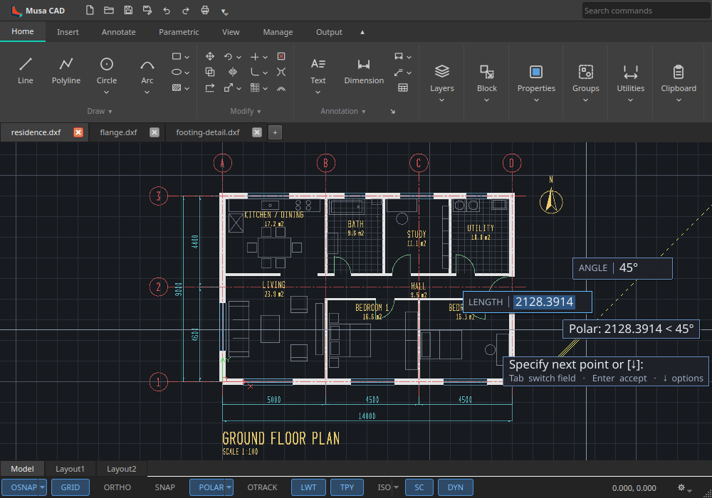
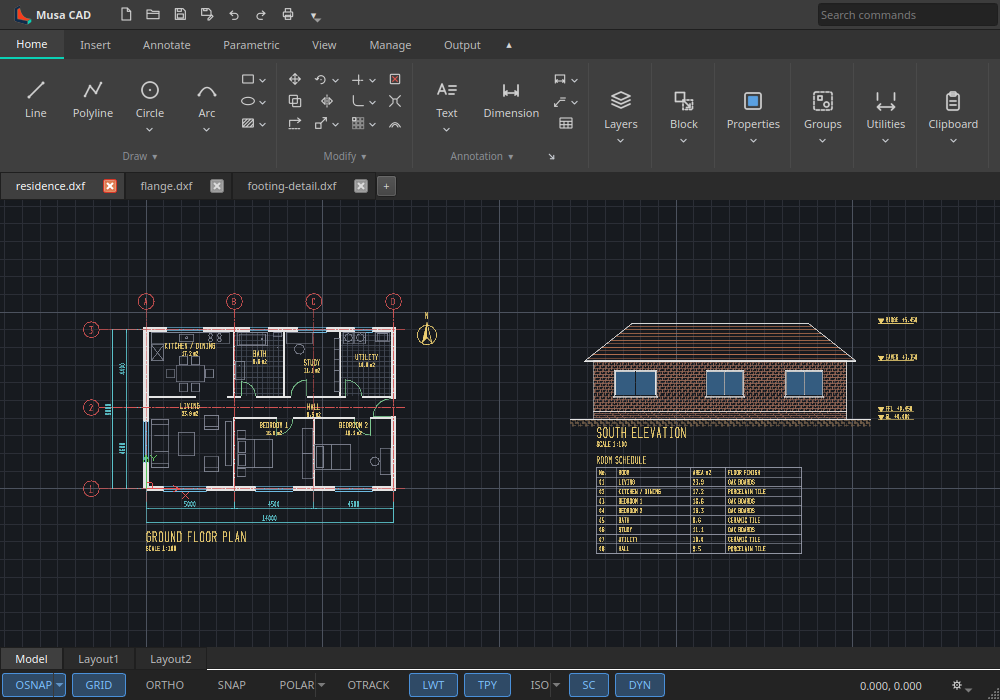
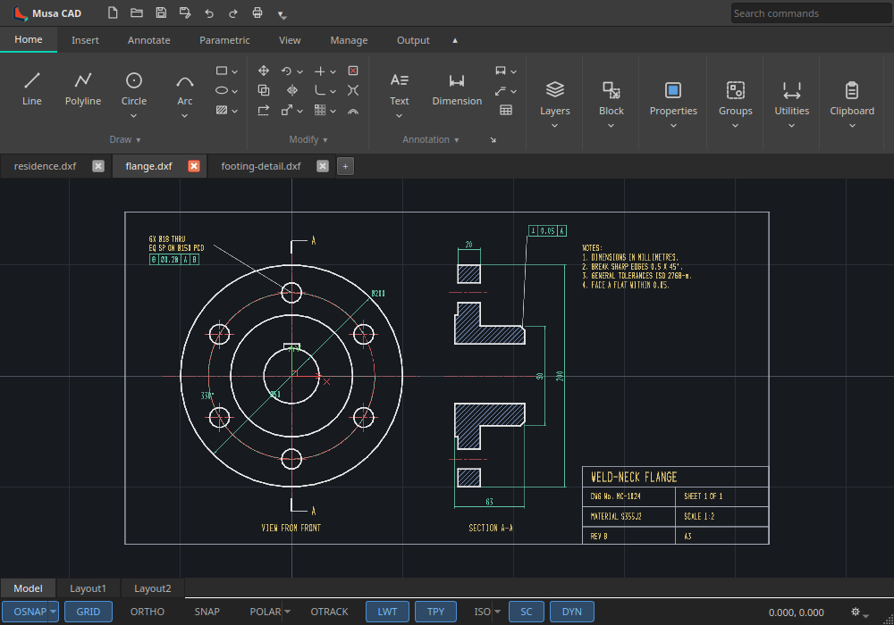
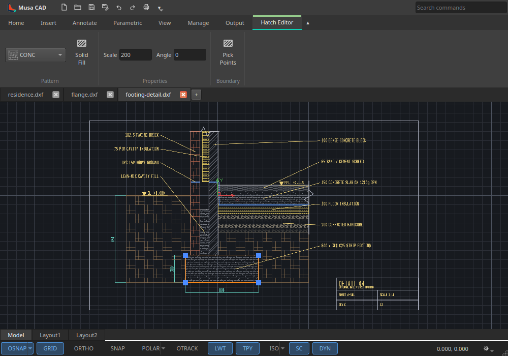

<p align="center">
  
</p>

# Musa CAD

**[Documentation & tutorials](https://wiki.musacad.org/)** ·
[Download](https://github.com/MusaCAD/MusaCAD/releases/latest) ·
[Report an issue](https://github.com/MusaCAD/MusaCAD/issues)

Free and open-source **2D CAD for drawing by hand or from code**. Use familiar
AutoCAD-style commands, a ribbon, object snaps and Dynamic Input, or generate drawings
with your own scripts and plot them to PDF without opening a window.

Available for Linux and Windows, with an [experimental macOS build](https://github.com/MusaCAD/MusaCAD/releases/tag/macos-experimental-0.9.0-1)
for Apple silicon. Built in C++23 with a GPU-accelerated viewport and its own geometry kernel.

[](https://idmo.app/p/musa-cad)

## Draw, automate, review

- **Draft interactively:** lines, arcs, polylines, hatches, dimensions, text, blocks,
  layers and layouts, with undo/redo and familiar keyboard shortcuts.
- **Use your preferred language:** Python, JavaScript, C#, shell scripts, or any tool
  that can write a file and run a process. Generate a plain-text `.musa` drawing or DXF,
  then use Musa CAD to check its text and plot it.
- **Run without a desktop:** batch PDF plotting, JSON text reports and exit codes work
  in scheduled jobs, on servers and in CI.
- **Work with an AI coding tool:** give it the drawing format and command-line guide.
  It can write a drawing, run the checks, plot a PDF for review, and revise the file.
- **Exchange drawings:** built-in DXF read/write, DWG through an external converter,
  and vector PDF output for sharing and printing.

## From code to a drawing and PDF

The [flange example](tools/examples/flange.py) uses only Python's standard library.
Change the diameter, hole count or bolt circle, then run these commands from the
repository with `musacad` on your PATH:

```sh
python3 tools/examples/flange.py flange.musa
musacad --check flange.musa --json
musacad --plot flange.musa flange.pdf --paper A4 --landscape --fit
```

Both `--check` and `--plot` run **without a display or an open application window**.
They also accept DXF files. To edit the result interactively, run `musacad flange.musa`.
On Windows, use the installed `musacad.exe` console launcher from scripts.
For AppImage and Flatpak commands, see the [command-line guide](https://wiki.musacad.org/scripting/command-line/).

<p align="center">
  
  <br><em>Generated by Python and plotted by Musa CAD 0.9.0. The drawing remains editable.</em>
</p>

Use this workflow for parts from a spreadsheet, drawing variants, title blocks from
project data, or a folder of review PDFs. The [fabrication pipeline](https://github.com/MusaCAD/fabrication_pipeline)
is a larger example that turns FreeCAD models into 2D drawing sheets with Musa CAD.

**Automation does not require a built-in scripting language.** Musa CAD uses files and
command-line processes for this workflow. It does not run AutoLISP, VBA or AutoCAD
plug-ins; existing routines need to be adapted. There is no remote-control API for the
running drawing window.

`--check` reports text overlaps, text outside the drawing frame and missing glyphs;
`--lines` adds text/line crossing checks. A clean report is not an engineering review.
Review the plotted sheet and verify dimensions, tolerances and design decisions before use.

- [Drawings from code](https://wiki.musacad.org/scripting/drawings-from-code/) — the file records and a worked Python example.
- [Command-line reference](https://wiki.musacad.org/scripting/command-line/) — options, exit codes, batch plotting and CI recipes.
- [AI workflows](https://wiki.musacad.org/scripting/ai-workflows/) — generate, check, plot, inspect and revise.
- [Documentation for AI tools](https://wiki.musacad.org/llms.txt) — a plain-text guide to the wiki.

## Documentation

The **[Musa CAD wiki](https://wiki.musacad.org/)** is the user guide and reference.

- **Start drawing:** [Installation and first steps](https://wiki.musacad.org/get-started/),
  [your first drawing](https://wiki.musacad.org/get-started/first-drawing/),
  or [coming from AutoCAD](https://wiki.musacad.org/get-started/coming-from-autocad/).
- **Learn the tools:** [User manual](https://wiki.musacad.org/user-manual/),
  [Dynamic Input](https://wiki.musacad.org/user-manual/dynamic-input/),
  and [command reference](https://wiki.musacad.org/reference/).
- **Find help:** [Keyboard shortcuts](https://wiki.musacad.org/reference/keyboard-shortcuts/)
  and [troubleshooting](https://wiki.musacad.org/troubleshooting/).
- **Work on Musa CAD:** [Developer guide](https://wiki.musacad.org/developer/),
  [repository documentation](docs/README.md), and [open issues](https://github.com/MusaCAD/MusaCAD/issues).

---

## Screenshots

<p align="center">
  
  <br><em>The ribbon, drawing tabs and Properties palette, with a wall of a house plan selected: its grips on the canvas, its layer and width in the palette.</em>
</p>

<p align="center">
  
  
  <br><em>Left: commands typed at the cursor, their matches offered as you type. Right: a wide polyline drawn with its length and angle at the cursor, polar tracking holding it to 45°.</em>
</p>

<p align="center">
  
  
  <br><em>Left: a house plan with its south elevation and room schedule. Right: a dimensioned flange with a section view and geometric tolerances.</em>
</p>

<p align="center">
  
  <br><em>The Hatch Editor on a wall and footing construction detail: brick, block, insulation, concrete, hardcore and earth.</em>
</p>

The drawings in these pictures are made by `tools/screenshots/make_drawings.py`, and
`tools/screenshots/capture.sh` takes the pictures again from a release build.

---

## Install

**Linux, from Flathub** — updates arrive with the rest of your apps:

<a href="https://flathub.org/apps/org.musacad.MusaCAD"></a>

```sh
flatpak install flathub org.musacad.MusaCAD
flatpak run org.musacad.MusaCAD
```

**Linux AppImage and Windows installer** — download from the
[latest stable release](https://github.com/MusaCAD/MusaCAD/releases/latest).

**macOS (Apple silicon, macOS 12 or later)** — use the separate
[experimental build](https://github.com/MusaCAD/MusaCAD/releases/tag/macos-experimental-0.9.0-1).
See the [Mac installation guide](https://wiki.musacad.org/get-started/install-macos/)
for setup and current testing status.

Musa CAD can check for updates once a day. Options (`OP`) turns the check off.
See [Updating Musa CAD](https://wiki.musacad.org/get-started/updating/) for each
installation method.

---

## Contributing and community

Bug reports, documentation fixes, testing, and code contributions are welcome.
Start with the [contribution guide](CONTRIBUTING.md) or
[open an issue](https://github.com/MusaCAD/MusaCAD/issues/new/choose).

- [Code of Conduct](https://github.com/MusaCAD/.github/blob/main/CODE_OF_CONDUCT.md)
- [Security policy and private vulnerability reporting](SECURITY.md)
- [Accessibility and reporting barriers](ACCESSIBILITY.md)

---

## Building

Musa CAD is **clone-and-build**:

```sh
cmake --preset dev          # Debug + AddressSanitizer/UBSan + unit tests
cmake --build --preset dev
```

The app lands at `build/dev/bin/musacad_app`. For an optimized build use the
`release` preset. Full prerequisites (a C++23 compiler, CMake 3.25+, Qt6 and
Ninja), Windows and macOS, and the ThreadSanitizer / CI notes are on the
wiki's [Building](https://wiki.musacad.org/developer/building/) page.

Run the tests:

```sh
ctest --preset dev
```

---

## Repository layout

```
src/core/      math, generational SoA store, IGeometryKernel + NativeKernel2D,
               threading primitives, snapshots, spatial index, undo/redo
src/render/    backend-agnostic GPU abstraction + OpenGL 4.1 backend, camera,
               grid, viewport renderer
src/command/   table-driven parser, per-command state machines, coordinate input
src/ui/        Qt6 frame, threaded GL viewport, command line, status bar
src/app/       main(), thread orchestration
include/musacad/   public headers mirroring src/
shaders/       GLSL (embedded into the build)
tests/         per-module unit tests + offscreen render & insertion benchmarks
docs/          technical references, release procedures and release history
scripts/       release + fixture-plotting helpers
assets/        branding (logo/icons), ribbon SVG icons, screenshots
```

---

## Support the project

Musa CAD is free and open source (LGPL-3.0). If it's useful to you, a donation helps
keep it actively developed and maintained — thank you!

- **Ko-fi:** [ko-fi.com/pranaykiran](https://ko-fi.com/pranaykiran)
- **PayPal:** [paypal.me/pranaykiran](https://paypal.me/pranaykiran)
- **UPI** (India): `kiranpranay12@okicici` &nbsp;·&nbsp; [tap to pay](upi://pay?pa=kiranpranay12@okicici&pn=Pranay%20Kiran&cu=INR)

---

## Acknowledgements

Musa CAD is authored and maintained by its [contributors](CONTRIBUTORS.md).

---

## License

Musa CAD is licensed under the **GNU Lesser General Public License, version 3 or
(at your option) any later version (LGPL-3.0-or-later)**. The full texts are in
[`COPYING`](COPYING) (GPL-3.0) and [`COPYING.LESSER`](COPYING.LESSER) (LGPL-3.0);
see [`LICENSE`](LICENSE) for a summary.

In plain terms: you may link Musa CAD into your own software,
**including proprietary software**, as long as you preserve the user's ability to
replace the Musa CAD component with a modified build (the LGPL "relink"
requirement) and keep the license notices. Modifications to **Musa CAD itself**,
if distributed, must remain available under the LGPL-3. Qt6 is linked
dynamically (also LGPL-3); DWG import/export runs through an **external converter
invoked as a separate process** — no DWG library is linked or shipped. Per-file
notices use SPDX identifiers; third-party licenses and the GPL-boundary evidence
are in [`docs/THIRD_PARTY_LICENSES.md`](docs/THIRD_PARTY_LICENSES.md).
