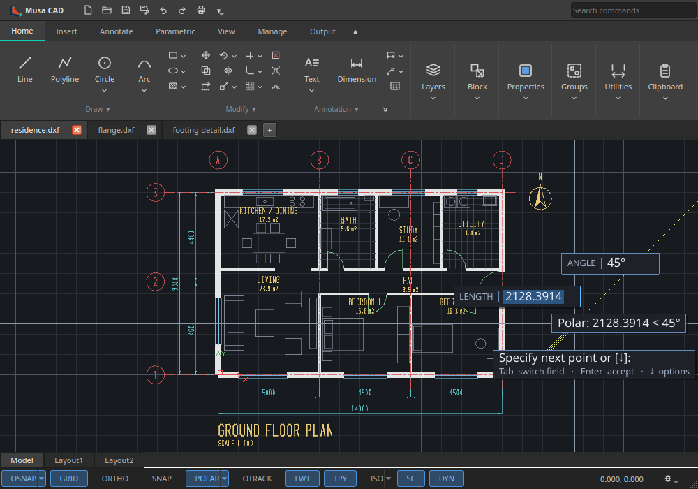

<!-- SPDX-License-Identifier: LGPL-3.0-or-later -->
<!-- Copyright (C) 2026 Pranay Kiran -->

# Musa CAD v0.9.0

**Clearer Dynamic Input and better drawing interchange.** DYN now uses compact, readable
text and named dimensions, with a distinct active field and visible typed constraints.
This release also includes the drawing, import/export and stability improvements since v0.8.0.

> **Linux AppImage and Flatpak are verified and available, with checksums. The Windows
> installer and checksum are available from the unchanged release workflow.**
> **Windows runtime testing on actual Windows hardware is pending**; a successful CI build does not constitute that testing. No macOS package
> is attached: GitHub rejected the unchanged workflow's `macos-14` runner as unsupported.
> The application also retains its existing macOS OpenGL viewport limitation.

## Dynamic Input

- Readable antialiased UI-font text replaces the thin yellow stroke digits, including tracking tips.
- Explicit **Length, Width, Angle, Radius and Diameter** labels identify each field.
- Blue selection marks the active live value; typing replaces it. A caret marks editing,
  and a padlock identifies a valid typed constraint, including after Tab moves to another field.
- Live angles show a degree symbol. Numeric entry, relative and absolute coordinates,
  Tab / Shift+Tab, Enter, Esc and F12 continue through the existing command pipeline.
- Prompts and entered values have separate rows. Drawing prompts include keyboard hints
  for switching fields, accepting input and opening command options.
- Fields avoid each other and the prompt. Screen-edge clamping keeps the fields, prompts
  and autocomplete visible; keyboard navigation keeps the selected suggestion in view.
  Long display text is shortened without changing the entered value.
- Typography and spacing scale with the display. Field placement uses the same camera as
  the geometry during pan and zoom.

## Drawing and interface improvements

- Hatches and multilines inside blocks, including their drawing and DXF persistence.
- Block-content multileaders and **MLEADERCOLLECT**; dimension and hatch association in DXF.
- Text in complex linetypes, all nine gradient patterns, hatch pick previews and more HATCHEDIT options.
- ARRAYPATH Rows and Tangent direction; ALIGNSPACE, RTEXT, SUPERHATCH, ARCTEXT, SYSVDLG and LAYOUTMERGE.
- Dimension, multileader and table style galleries; extended ribbon tooltips and floating panels.

## Interchange and stability

- DXF export uses consistent AutoCAD 2000 structure, allowing AutoCAD-family readers and
  ODA's DWG conversion to read the output. Radial and angular dimensions import correctly,
  with dimension text overrides, leader vertices and mirrored entities preserved.
- Fixes for closing the application, rendering into a hidden window, and clicked points
  under decimal-comma locales. Older graphics hardware can fall back to software rendering.
- Numerous command, layer, clipboard, hatch, dimension and editing fixes since v0.8.0.

The native drawing format advances from v45 to **v49**. Older files open normally;
files saved in this release require v0.9.0 or newer.

See the [full changelog](https://github.com/MusaCAD/MusaCAD/blob/v0.9.0/CHANGELOG.md).

## Verification

- The published AppImage and Flatpak passed the complete GUI self-test in isolated, window-managed displays, including DYN entry, Tab, Enter, Esc, F12 and the Delete typing guard.
- Headless drawing validation and A4 PDF output passed for both Linux packages from outside the project directory.
- The Flatpak packages the identical verified Linux CI application binary with the KDE 6.11 runtime; its installed payload hash matches the AppImage application binary. It was tested with Qt 6.11.3. A separate SDK source rebuild was not completed.
- Focused tests passed: **77 test cases, 2,429 assertions** covering DYN, coordinates, camera, snapping and geometry support.
- The renderer passed AddressSanitizer and UndefinedBehaviorSanitizer checks. DYN was visually checked at normal and high-DPI scaling.
- The full unit regression suite was not completed; its build exceeded the available practical resources.
